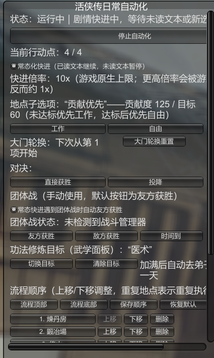
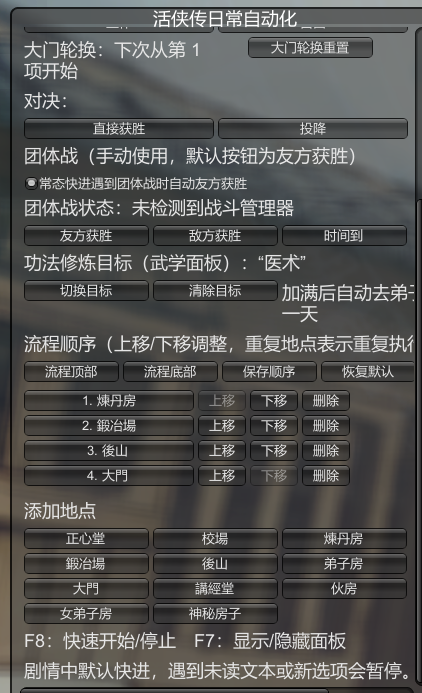

# 活侠传日常自动化

**《活侠传》自由行动日常自动化：F8 一按，日常自己跑。**

这是一个独立的 BepInEx 6 (Mono) 插件，为“活侠传”自动执行自由行动环节的日常养成流程：地点循环、工作/自由选择、武学修炼、打铁炼丹加点、睡觉过天、大门轮换、剧情快进、暴死自动回档。

当前版本：`2026.10.17`（公开发布版；版本号按发布日期取，Git 标签同 `v2026.10.17`）。

## 截图

游戏里的 **F7 面板**——状态、行动点、常态化快进、贡献优先、大门轮换进度、对决与团体战按钮、修炼目标，一屏管完：



**流程顺序**（列表高度随条目数自适应）、**添加地点**与快捷键说明：



## 安装

**推荐做法：下载 Release 里的 `LOMDailyAutomation-v2026.10.17.zip`，解压到任意位置，双击「点我安装.bat」。** 安装包已自带 BepInEx 运行时（BepInEx 6 / Doorstop，LGPL-2.1），就算你之前什么 mod 都没装过，装完就能直接玩，不必再去别处下载 BepInEx。

也可以手工安装：把压缩包里的内容复制到游戏根目录（`Mortal.exe` 所在文件夹），装好之后游戏根目录应有 `winhttp.dll`、`doorstop_config.ini`、`.doorstop_version`、`BepInEx\core\`、`BepInEx\plugins\LOMDailyAutomation\LOMDailyAutomation.dll`。注意别用“解压到子文件夹”的方式，否则游戏读不到。

确认装上了：启动一次游戏，看 `BepInEx\LogOutput.log` 里有 `活侠传日常自动化已加载。按 F8 开始/停止，按 F7 显示/隐藏面板。` 即可。卸载只需删掉 `BepInEx\plugins\LOMDailyAutomation` 文件夹，不影响存档。

## 使用

1. 启动游戏并进入“自由行动”界面。
2. 面板默认显示；点击“开始自动化”或按 `F8` 开始。若当前已经打开武学修炼面板或毒药/兵器升级面板，会直接先自动加点/修炼，再回到日常流程；否则按面板中的顺序循环寻找当前可用地点。
3. 在面板“流程顺序”区用“上移/下移/删除”和“添加地点”按钮调整流程；增删/移动/恢复默认本身会立即保存，列表上方的“保存顺序”也可随时手动写入配置。重复添加同一地点即可重复执行。
4. 再按一次 `F8` 或点击“停止自动化”停止；按 `F7` 显示/隐藏面板。
5. 面板中的“工作/自由”按钮用于设置进入地点后的优先子选项（两档）。自动化会解析地点菜单选项（格式为“活动id+类别+脚本”，如 `incense+work+incense` = 上香·工作），优先点击目标类别；菜单中没有该类别时自动改选另一类别；遇到剧情或对话选项时暂停等待人工处理。
6. “团体战胜负控制”是独立手动工具，不属于日常自动化；进入团体战时可在面板点击友方获胜、敌方获胜或时间到。
7. “对决”也是独立手动工具：“直接获胜”、“投降”，以及**“加血（回满）”**——剧情里有些对决要求你“撑过若干回合、不胜不败”，血量被一点点磨掉时点一下即可回满（走游戏原生的加血通路，和关卡事件加血一致）；不会随日常自动化自动触发。
8. **大门（出行菜单）**：把“大门”加入流程后，自动化在门口按列表顺序**轮换选择**——这次选第 1 项、下次第 2 项，依次循环（条件不满足的项自动跳过），保证闹市/外堡/茶肆/药铺/澡堂/农田/行商等各条线的事件都会轮到、不会错过。进度存在配置里（`DoorOptionCursor`），面板“大门轮换重置”可从头再来；日志为 `大门菜单轮换选择=第 N/M 项：…（下次从第 N+1 项开始）`。
9. 自动化默认开启“常态化快进”：已读文本会继续快进，只有未读文本才暂停自动化并恢复正常播放；剧情选项和主线/支线行动提示也会停止。快进倍率固定为游戏原生 10x（实测请求更高倍率会被游戏取消，有效速度反而掉到约 1x）；日志会每两秒输出 `[快进测速]`，显示 `Time.time/真实时间` 的有效倍率。游戏原生 `SpeedTimeScale()` 会写回 10，插件会在常态快进时覆盖这个写回；在常态快进时遇到团体战，默认自动选择友方获胜，和日常启停开关相互独立。
10. **面板自动化**：练功后打开的“武学面板”会自动修炼功法——优先修炼能提升“关注目标”（面板切换/清除按钮设置：属性/武功类别之外，还有“医术”“战术”两个天赋目标——战术对应孙子兵法、历战血书这类加“战术”的书）的功法；目标判定覆盖整本书“当前级及以后”各级的加成（医书等多把目标加成放在第 10 级，只按当前级会漏判），多本符合时优先“目标级更近”的、再优先点数消耗少的；前置条件不满足的自动跳过、改修其他可修的；候选日志对这类书标注 `目标@第N级`，修炼日志标注“（目标功法·到第N级获得）”。**目标功法被前置卡住时自动补课**：会收集被卡住的前置属性（如温阳活血符的“阴阳内功≥60”），优先修炼能提升这些属性的功法（候选标注 `助前置`、日志“前置功法·提升…／目标功法前置未满足：…”），前置达标后自动切回目标功法；若当前没有可提升前置的书，会在日志说明原因。目标循环中的“医术”按游戏真实的战斗技能 `G002`（天赋“醫術”）筛选，不是单纯比较显示文字；打铁/炼丹打开的“毒药/兵器升级面板”会自动加点，点满后自动进化解锁下一项（消耗点数与银两）。在这些面板里直接按 F8/开始按钮，也会立即执行加点/修炼。
11. **加满自动进下一天**：当武学、毒药、兵器全部无可加点项时，自动化会前往弟子房休息（睡觉），并在 [休息/饮食/折纸/赌博] 菜单中按对“心性”收益最高的选项自动选择，进入下一天后继续日常。
12. 刚进入自由行动界面时，游戏会先播放当天任务对话，期间自动化显示“等待中：游戏处理中”，等界面真正可操作后就会自动开始，属正常现象；面板“状态”栏会显示当前阶段。
13. **破庙养成**：遇到破庙菜单时按 `BreakTempleOptionOrder` 选择饮食、无所事事、修炼武功或打工赚钱；修炼武功会接入武学面板，打工赚钱与无所事事的二级菜单也会自动选可用项并继续。
14. **F9 作弊选单技能扩展**（可选）：如果你装了“活俠傳作弊測試選單”（F9 打开的那个），它的下拉列表末尾会追加“★医术”“★战术”——选中后输入数字点“設定數值”即可直接改等级（0 到满级自动钳制）；没装该插件时这项自动跳过，互不影响。

配置文件由 BepInEx 自动生成在 `BepInEx/config/com.codex.lom.daily-automation.cfg`。常用配置：

```ini
ToggleKey = F8
WindowToggleKey = F7
ShowWindowAtStartup = true
AlwaysFastForward = true
FastForwardTimeScale = 10
AutoWinGroupBattleDuringFastForward = true
ActionOrder = 正心堂,校场,煉丹房,鍛冶場,後山,弟子房,講經堂,伙房
InnerActionPreference = 自由
StopOnMainMission = true
StopOnSubMission = false
ActionTimeoutSeconds = 90
DoorOptionCursor = 0
DiagnosticLogging = true
ContributionTarget = 60
FocusStat = 医术
NightOptionOrder = 折纸,休息,饮食,赌博
BreakTempleOptionOrder = 修炼武功,打工赚钱,无所事事,饮食,休息
```

地点可以使用游戏中的中文名称，也可以使用 `MindHall`、`TrainingGround`、`Alchemy`、`Forge`、`BackMountain`、`DiscipleRoom`、`LectureHall`、`Kitchen` 等英文别名。

## 诊断日志

`DiagnosticLogging = true`（默认）时，自动化在等待状态每秒输出一条诊断日志到 `BepInEx/LogOutput.log`，形如：

```text
[DailyAutomation] [诊断] free=T processing=F action=3/3 awaiting=F story=F storyCaptured=F 距上次进度=2.3s | 控制器=11 正心堂[_active=T 可点=F 行动点=T] ...
```

- `processing=T` 表示游戏正处于“处理中”（转场或当天任务对话未结束），此时地点不可点击，自动化会等待。
- 每个地点的 `_active / 可点 / 行动点` 表示该地点当前状态。
- 排查完成后可将 `DiagnosticLogging` 改为 `false` 关闭。

## 边界与回滚

插件只调用游戏现有的 `PositionController.OnPositionClick()`，不会修改游戏程序集或存档文件。删除 `BepInEx/plugins/LOMDailyAutomation/LOMDailyAutomation.dll` 即可禁用；如需一并清除配置，删除 `BepInEx/config/com.codex.lom.daily-automation.cfg`。

自动化覆盖自由行动地点、地点子选项和剧情快进。团体战与对决按钮是独立手动工具，不会由日常自动化触发。遇到未读文本、剧情选项或任务提示时，会停在游戏当前状态；战斗/战役结束后继续日常流程。

## 版本历史

> 版本号按发布日期取（`年.月.日`，Git 标签加 `v` 前缀，例如 `v2026.10.16`）；`0.x` 为开发期编号。

- `2026.10.17`：F9 作弊选单技能扩展（下拉列表追加 ★医术 / ★战术，可直接设定等级）；另含 2026.10.16 当日稍后并入的：功法目标新增战术、对决加血（回满）、面板窗口加宽。
- `2026.10.16`（首个公开发布）：即开发期 0.5.5 的全部功能——地点循环与子选项自动选择（贡献优先）、武学面板自动修炼（整本书目标判定 + 前置自动补课 + 医术 G002）、毒药/兵器升级面板自动加点与进化、加满自动睡觉进下一天、大门按列表顺序轮换、常态化快进（固定 10x）、暴死自动回档、团体战/对决手动工具、F7 面板与流程顺序编辑修复。
- `0.1.0`：自由行动地点自动执行（F8 开关）。
- `0.2.0`：F7 面板、流程顺序编辑、剧情默认快进、未读文本/选项暂停。
- `0.3.0`：地点子选项自动选择（工作/自由/修炼）、团体战默认友方获胜、战斗/剧情后自动继续。
- `0.3.1`：界面处理中不再误判失败（等待与重试）；等待期间每秒诊断日志；点击未生效自动重试；构建/测试脚本编码修正。
- `0.3.2`：实装地点子菜单自动选择（解析“活动id+类别+脚本”，两档：工作/自由，缺失自动改选另一档）；修复“活侠传助手内部调用被误判未读文本”导致的误停；面板子选项按钮改为两档。
- `0.3.3`：修复菜单选项重复捕获导致的按钮槽位错位（改为只挂真正的建按钮入口，捕获顺序=槽位顺序）。
- `0.3.4`：贡献度优先策略（`ContributionTarget`，未达标优先工作，达标后优先自由）。
- `0.4.0`：面板自动化——武学面板自动修炼（关注目标 `FocusStat`、前置跳过、点数消耗少优先）、毒药/兵器升级面板自动加点与进化解锁；全部加满后自动前往弟子房休息、夜晚菜单按心性收益选择（`NightOptionOrder`）并进入下一天。
- `0.4.1`：修复锻造/炼丹升级面板卡住——改为驱动并关闭外层 `UpgradePanel`（X=设置关闭标志，解除脚本等待；点满自动进化下一项，无可进化则直接关闭退出）；再次启动自动化时从上次执行的地点之后接续（编辑顺序/恢复默认时回到第一项）。
- `0.4.2`：增加常态化快进开关（已读文本继续、未读文本暂停）；可从修炼/升级面板直接开始加点；团体战改为独立手动按钮；增加对决“直接获胜/投降”按钮。
- `0.4.3`：快进倍率可调；增加流程列表置顶/置底；未读文本暂停后可在原剧情界面按 F8 继续；武学面板未就绪时自动重试；常态快进遇团体战默认自动友方获胜。
- `0.4.4`：炼丹房不再按资源状态擅自跳过，用户可在流程列表直接删除地点；打铁房没有可执行设备升级时自动选“工作”；常态快进遇团体战的自动友方获胜独立于日常开关，团体战按钮在检测到战斗后可直接操作并显示不可结算原因。
- `0.4.5`：功法目标增加真实的医术战斗技能（G002）筛选；支持破庙养成菜单及其修炼/打工下一级菜单，顺序由 `BreakTempleOptionOrder` 配置。
- `0.4.6`：覆盖游戏原生 10 倍快进写回；倍率上限扩展到 1000x；增加有效倍率测速日志和 200x/500x/1000x 面板按钮。
- `0.4.7`：纳入 0.4.6 打包后的日志显示修正（武学面板结束日志使用目标显示名，修正“医术”显示）；重建安装包。
- `0.4.8`：实机反馈修复——快进倍率固定 10x（>10 会被游戏取消，实测反而约 1x）；点击选项后已读文本继续快进（持续重申快进标志）；支线提示默认不再阻止启动（StopOnSubMission=false）；对决“直接获胜/投降”按钮常开、标签去掉括号。
- `0.4.9`：武学面板诊断增强（逐本候选日志、需求为 0 的功法逐点投入）。
- `0.5.0`：暴死自动回档——GameOver/结局面板触发时自动读取游戏自动存档（auto_free 等）回到上一操作前并继续；同一处连续 3 次回档会停止等待人工；可用 AutoReloadOnDeath 关闭。
- `0.5.1`：面板“流程顺序”编辑修复——删除/上移/下移改为帧尾延迟应用，删除地点后列表立即重排、不再残留空白行（原实现同帧改动控件数量导致 IMGUI 布局错乱）；「保存顺序」「恢复默认」移到序列列表上方的按钮行，与「流程顶部/流程底部」同行，无需拖动滚动条即可见。
- `0.5.2`：武学目标判定修复——原先只检查“当前等级”的升级加成，而医书（温阳活血符、备急千金要方、伤寒杂病论等）的医术加成都在第 10 级，导致医术书从不被优先、点数被投进不产医术的书；现改为检查“当前级及以后”整本书的加成（含消耗类加成），选中排序为“目标书优先 → 目标级更近优先 → 点数消耗少优先”，日志标注 `目标@第N级` / “（目标功法·到第N级获得）”。
- `0.5.3`：目标功法前置自动补课——目标功法被前置条件卡住时（如温阳活血符需阴阳内功≥60、部分书第 6 级起需学问≥10），自动收集缺失的前置属性并作为“前置辅助”次级目标，优先修炼能提升这些属性的可修功法（含 `_center` 类数值方向判断）；前置达标后自动切回目标功法；没有可提升前置的书时在日志说明。排序：目标书 → 前置辅助书 → 其他。
- `0.5.4`：面板“流程顺序”列表高度改为随条目数自适应（原来固定 280 像素，删掉几个地点后下方留一大片空白，容易误以为下面没有内容）；列表不需要滚动时不再显示滚动条。
- `0.5.5`：大门（出行菜单）支持按列表顺序轮换选择——识别 `DoorMenuDialog`，每次进入大门从上次进度起选第一个可交互项并持久化（`DoorOptionCursor`），条件不满足的项自动跳过，保证所有出行/事件选项轮流触发；面板显示进度并支持“大门轮换重置”。

## 重新构建

在游戏根目录的 PowerShell 中执行 `LOMDailyAutomation-src/build.ps1`；加 `-NoInstall` 只构建到 `LOMDailyAutomation-src/bin`，不覆盖已安装 DLL（游戏运行中无法覆盖时使用）。地点名称解析测试执行 `LOMDailyAutomation-src/test-parser.ps1`。构建脚本使用游戏目录内的 Unity Mono 程序集和本机 Roslyn，不会下载额外依赖。

开发状态、逆向情报与接力事项见 `LOMDailyAutomation-src/STATUS.md`。
